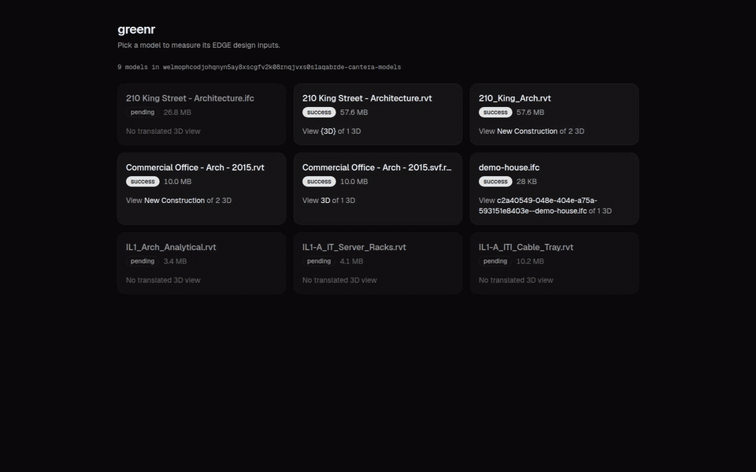
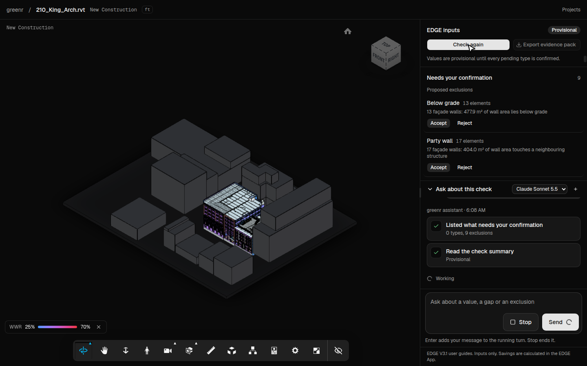
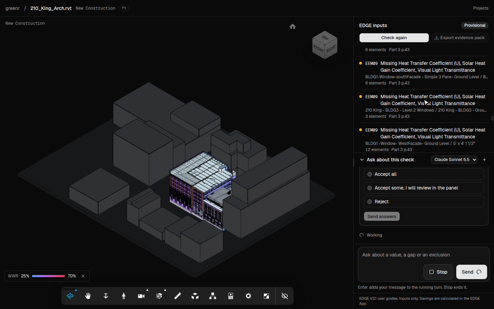
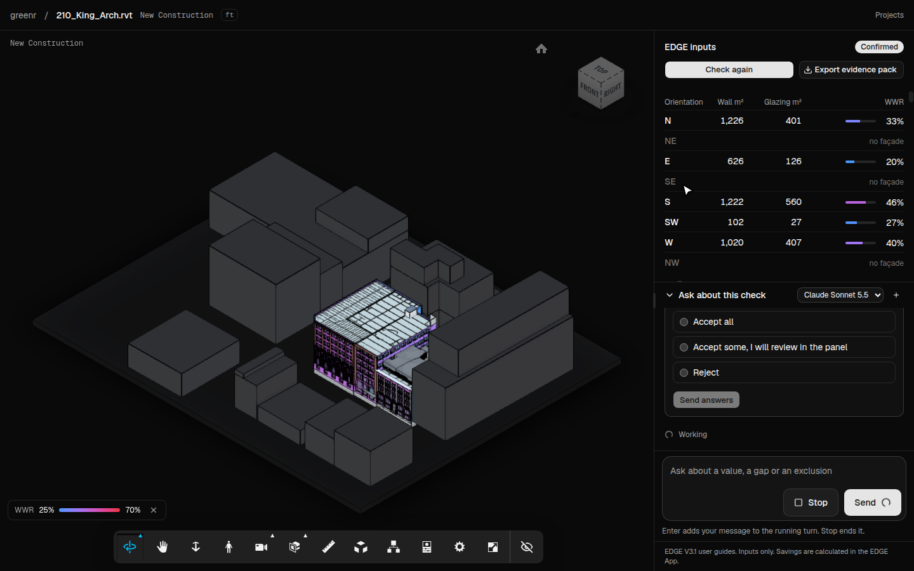
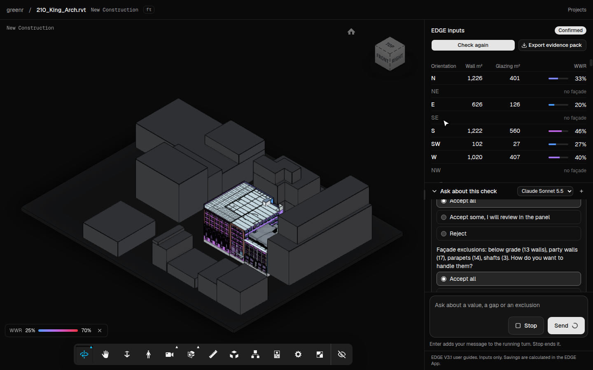
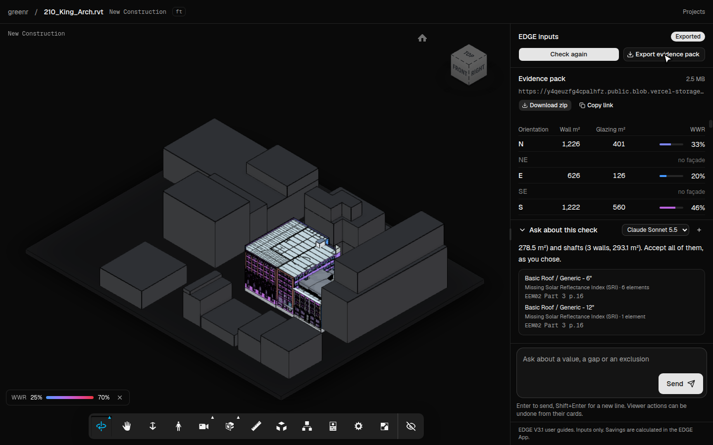
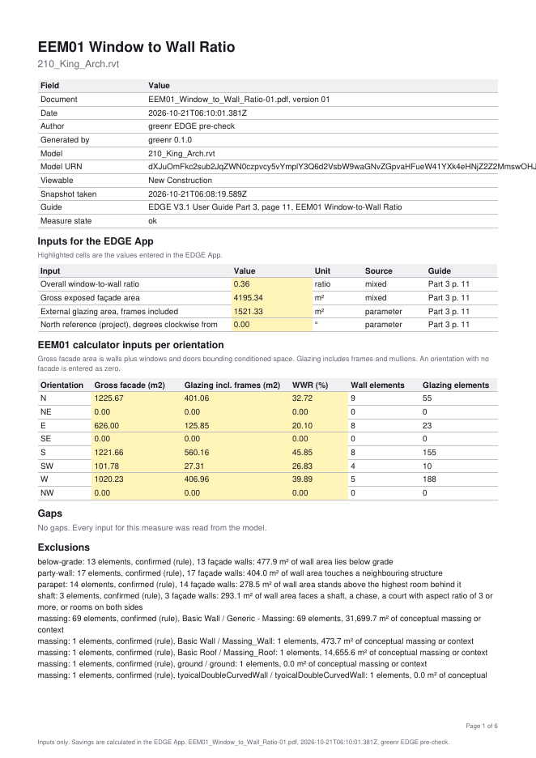

# greenr



Live at https://greenr-omega.vercel.app

EDGE pre-check in the Autodesk viewer. Open a Revit model, click **Check for EDGE**, and get the design inputs you type into the EDGE App today. You get the window-to-wall ratio per orientation, the areas, the floors and the floor-to-floor height, plus a list of what the model cannot prove yet. Then export an evidence pack shaped the way the auditor asks for it.

greenr computes inputs only. Savings are calculated in the EDGE App. It never shows a pass or a fail.



## What it does

- **Measures the EEM01 window-to-wall ratio** for eight orientations from the viewer's property database and fragment geometry, with no Design Automation. Envelope walls are found by probing the Revit Rooms on each side of every wall. Openings are matched to their wall by geometry. Frames count as glazing, as EDGE requires.
- **Reads the Design tab inputs.** Gross internal area from rooms, floors above and below grade with EDGE's 50% rule, the area-weighted floor-to-floor height, the roof area, and the skylight share of the roof area.
- **Lists gaps** next to their EDGE code and guide page. Glazing types with no U, SHGC or VT value go under EEM09. Roof types with no SRI go under EEM02.
- **Asks before it decides.** Element types are classified by a rules table first, then by a decision model through the Vercel AI Gateway. Low-confidence types and proposed exclusions, such as site massing and below-grade walls, wait for a person. Values stay provisional until every pending item is confirmed.
- **Colours the model** by WWR and selects the elements behind every row and gap.
- **Exports an evidence pack.** One PDF per measure with the entered values highlighted, a CSV that mirrors the EDGE per-orientation calculator with explicit zeros, four elevation PNGs and a JSON manifest. Versioned file names follow the auditor guide.
- **Runs an agent in the panel.** It explores the model with the same tools, proposes exclusions, and answers questions with cards you can click.











## How a check runs

1. The viewer loads the model's "New Construction" view, the one that carries Rooms.
2. `readSnapshot` scans the property database once and walks the fragment triangles of walls, panels, windows and doors. About 0.3 s on an 18,000-object model.
3. `classifySnapshot` assigns a role to every type by rule. Leftovers go to `typesafe-ai/jev`, with `openai/gpt-6-luna-decisions` as the fallback below 0.6 confidence.
4. `proposeExclusions` lists massing, below-grade and party walls for the person to accept.
5. `computeRun` runs the measures registry. Every measure is a pure function of the snapshot, the classifications and the confirmed exclusions.
6. The run is saved to Convex. Reopening the project shows the last run.

## Stack

Next.js 16, shadcn (nova preset on Base UI), Geist, Autodesk Platform Services Viewer v7, libfx in the browser through cantera's viewer components, Vercel AI Gateway, Convex, Vercel Blob, pdf-lib and fflate.

## Run it

```bash
pnpm install
cp .env.example .env.local
npx convex dev --once
pnpm dev
```

`.env.example` lists the variable names. Fill in `APS_CLIENT_ID`, `APS_CLIENT_SECRET`, `AI_GATEWAY_API_KEY`, `BLOB_READ_WRITE_TOKEN`, `NEXT_PUBLIC_CONVEX_URL` and `CONVEX_DEPLOYMENT`.

Models are listed from the APS bucket `<client-id>-cantera-models`. The project page is `/p/<slug>`. `GET /api/models` returns the slugs.

## Verify

Every unit has a rerunnable check in `scripts/verify/`. `pnpm test` runs the engine, classification, export and persistence tests, including a golden test that reproduces the 210 King Street table.

`scripts/verify/e2e.mjs` drives the deployed page with agent-browser through the full flow. It checks, confirms, answers the agent, exports, and reloads. It first resets the 210 King project through the internal `admin:resetProject` mutation, so it needs the Convex CLI signed in to the same deployment. Set `E2E_RESET=0` to skip the reset.

```bash
BASE_URL=https://greenr-omega.vercel.app node scripts/verify/e2e.mjs
```

`scripts/verify/record-demo.mjs` records the demo above and writes every image in `docs/media/`. It records with `agent-browser record` and cuts the long waits with ffmpeg. The acceptance and the agent question only show on a clean project, so reset it first.

```bash
npx convex run --prod admin:resetProject '{"slug":"<slug>"}'
BASE_URL=https://greenr-omega.vercel.app node scripts/verify/record-demo.mjs
```

## Measured on 210 King Street

The table is the run after you accept the rule-proposed exclusions (massing, below-grade, party, parapet and shaft walls). Before acceptance, N reads 28% and S 42%.

| Orientation | Gross façade m² | Glazing m² | WWR |
|---|---|---|---|
| N | 1,225.7 | 401.1 | 32.7% |
| E | 626.0 | 125.8 | 20.1% |
| S | 1,221.7 | 560.2 | 45.9% |
| SW | 101.8 | 27.3 | 26.8% |
| W | 1,020.2 | 407.0 | 39.9% |

NE, SE and NW have no façade. North is project north, since the model sets no true north. The spike that proved the method and its caveats are in `.audit/greenr.tsv`.

## Known limits

- The method needs Revit Rooms. A view without rooms gives no envelope.
- North is the project's +Y unless you set it in the panel. No bucket model records a true north.
- Thresholds were tuned on one model. Check one project by hand before you trust the numbers.
- Party walls are caught only when the neighbours are modelled.
- Viewer screenshots support the architect's drawings. They do not replace them.

## Roadmap

Each item is a GitHub issue.

- Server-side durable agent (https://github.com/mrestrepoj10/greenr/issues/1)
- Headless re-runs in Vercel Sandbox (https://github.com/mrestrepoj10/greenr/issues/2)
- EEM04 shading inputs (https://github.com/mrestrepoj10/greenr/issues/3)
- EEM05 and EEM08 U-values via Design Automation (https://github.com/mrestrepoj10/greenr/issues/4)
- Autodesk Docs sign-in (https://github.com/mrestrepoj10/greenr/issues/5)
- Auth and a firm-level type profile (https://github.com/mrestrepoj10/greenr/issues/6)
- Spanish UI (https://github.com/mrestrepoj10/greenr/issues/7)
- CASA Colombia (https://github.com/mrestrepoj10/greenr/issues/8)
- Guide version table beyond V3.1 (https://github.com/mrestrepoj10/greenr/issues/9)

## Sources

EDGE V3.1 user guides, Parts 1, 2, 3, 4, 5 and 8, and the Part 9.1 energy methodology, from edgebuildings.com. Not affiliated with IFC or EDGE.
